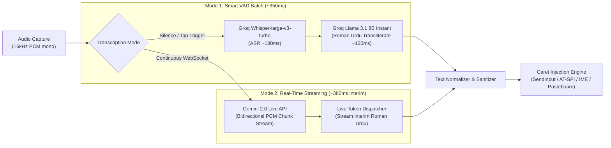
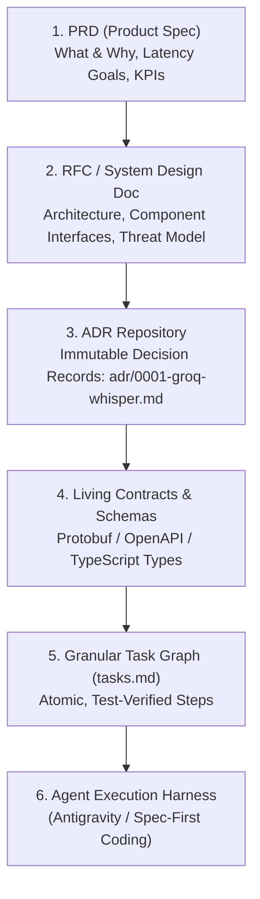

# Project SonicScript: Cross-Platform System-Wide Voice Dictation System
**Document Class:** System Design Document (RFC) & Product Requirements Document (PRD)  
**Target Hardware Matrix:**
* **Primary Laptop:** Windows 10/11 + Ubuntu (Dual-boot, Wayland & X11)
* **Android Device:** Google Pixel 6 (Android 14/15)
* **iOS Device:** iPhone 12 (iOS 17/18)
**Primary Cloud Engines:** Groq Whisper-large-v3-turbo + Groq Llama 3.1 8B (Batch VAD ~350ms) / Gemini 2.0 Live WebSocket (Real-time Streaming)

---

## 1. Executive Summary & Problem Definition

### 1.1 The Core Problem
Native desktop and mobile dictation engines (e.g., Windows Voice Typing `Win + H`, Apple Dictation, Gboard Voice) fail fundamentally for bilingual South Asian speakers:
1. **Script Mismatch:** Urdu and Hindi speech are phonetically identical in colloquial conversation. Native engines force Perso-Arabic (`اردو`) or Devanagari (`हिंदी`) script output. South Asian users communicate digitally in **Roman Urdu** (Latin script).
2. **Code-Switching Breakdowns:** Everyday South Asian speech seamlessly blends English technical terms with Urdu grammar (*e.g.*, *"PR merge kardo aur deployment check karlo"*). Standard engines either garble the English words into phonetic Urdu/Hindi script or hallucinate random translations.
3. **Desktop Friction:** Windows `Win + H` has sluggish activation latency (>1.5s), requires continuous speech without configurable push-to-talk, and frequently drops punctuation.

### 1.2 Target Objectives & KPIs
* **Latency:** End-to-end latency from key release / speech pause to caret text injection: **$\le 500\text{ ms}$ (p95)**.
* **Cost:** **$0.00 / month** on free developer tiers (Groq / Gemini AI Studio), or **$0.20 per 1,000 dictations** under heavy commercial API loads.
* **Accuracy:** Zero script divergence. 100% Roman Urdu output for Urdu/Hindi speech; 100% standard English output for English speech; seamless handling of code-switched technical vocabulary.
* **UX:** Two distinct activation models:
  1. *Push-to-Talk (Hold-to-Speak)*.
  2. *Focus-Aware Auto-Overlay ("Windows+H on Steroids")*: Automatically summons a non-activating ripple/ring HUD whenever an editable input caret is focused, automatically vanishing when focus is lost.

---

## 2. Speech-to-Text & Transliteration Pipeline

### 2.1 Real-Time Streaming vs. Smart VAD Silence Chunking
1. **Option A: Smart VAD Silence Chunking (Recommended for Daily Typing):**
   - User focuses on text field and speaks. A continuous audio ring buffer monitors speech with **Silero VAD**.
   - When the user finishes a thought (600ms silence detected or explicit tap on the ring), the audio buffer is dispatched to **Groq Whisper-large-v3-turbo** + **Groq Llama 3.1 8B**.
   - Total latency: **~350ms**. Injected cleanly into the caret in one fluid motion without character-by-character visual jitter.
2. **Option B: Real-Time Live Streaming (Gemini 2.0 Live WebSocket):**
   - Direct bidirectional WebSocket connection to Gemini 2.0 Live API.
   - 16kHz PCM audio buffers are streamed every 250ms.
   - Interim Roman Urdu tokens arrive in real-time and stream into the focused input field dynamically.

---

## 3. Platform Architecture Matrix (Device Specific)

### 3.1 Windows Subsystem (Laptop)
* **Focus Detection Engine:**
  - Implements Win32 `SetWinEventHook` listening to `EVENT_OBJECT_FOCUS` and `EVENT_SYSTEM_FOREGROUND`.
  - Queries `GetGUIThreadInfo` to track `guiInfo.hwndFocus` and `guiInfo.rcCaret`.
  - When the active control is an editable text box (`Edit`, `RichEdit`, `Scintilla`, or UI Automation `UIA_EditControlTypeId`), the floating pill automatically spawns near the caret.
  - When focus transitions to a scrollable container, desktop, or non-text element, the overlay seamlessly slides away.
* **UI Overlay:**
  - Borderless, glassmorphic HUD with an animated ripple/ring visualizer.
  - Extended styles: `WS_EX_NOACTIVATE | WS_EX_TOOLWINDOW | WS_EX_TOPMOST`. It never steals keyboard focus from VS Code, Chrome, Slack, etc.
* **Text Injection:**
  - Clipboard preservation paste: Saves clipboard $\to$ copies transcribed Roman Urdu $\to$ fires synthetic `Ctrl + V` via `SendInput` $\to$ restores original clipboard.

### 3.2 Ubuntu Subsystem (Laptop Dual-Boot: Wayland & X11)
* **Focus Detection Engine:**
  - Connects to Linux Accessibility D-Bus (`org.a11y.atspi.Event.Object:StateChanged:focused`).
  - Detects when an element with AT-SPI role `ROLE_TEXT`, `ROLE_ENTRY`, or `ROLE_TERMINAL` receives focus.
* **UI Overlay:**
  - On Wayland: Utilizes the `wlr-layer-shell` protocol with `keyboard_interactivity = none` to float above active windows.
  - On X11: Native overlay window with `override_redirect = True`.
* **Keystroke & Paste Injection:**
  - Wayland: Emulated injection via `libei` / `ydotool` + `wl-copy`.
  - X11: `xdotool` + `xclip`.

### 3.3 Google Pixel 6 (Android 14/15)
* **Architecture Option 1: Native Voice IME Keyboard (Rock Solid):**
  - Android `InputMethodService`. Whenever any text field is focused, the keyboard pops up with a prominent central Glowing Ripple Mic.
  - Text insertion: `InputConnection.commitText(text, 1)`. 100% reliable, zero accessibility scrutiny, supports backspace and cursor control.
* **Architecture Option 2: Floating Accessibility Bubble (Over Gboard):**
  - Runs an `AccessibilityService` that monitors `TYPE_VIEW_FOCUSED`.
  - If `isEditable == true`, shows a small floating ripple bubble via `SYSTEM_ALERT_WINDOW`.
  - Tap or speech pause automatically injects text via `AccessibilityNodeInfo.ACTION_SET_TEXT`.

### 3.4 iPhone 12 (iOS 17/18)
* **Hardware & OS Constraints:**
  - iPhone 12 does not have the Action Button (available only on 15 Pro/16).
  - Apple strictly denies microphone access (`AVAudioSession`) inside Keyboard Extensions (`UIInputViewController`).
  - Apple does not allow arbitrary third-party floating overlay windows over other apps (`SYSTEM_ALERT_WINDOW` does not exist on iOS).
* **The Premier iPhone 12 Implementation:**
  1. **AssistiveTouch Floating Circle Integration (User's Floating Circle):**
     - Enable iOS **AssistiveTouch** (the native on-screen floating circle).
     - Customize the Single-Tap or Double-Tap action of AssistiveTouch to trigger our app's **App Intent / Shortcut**: *"SonicScript Dictate"*.
     - Tap the floating circle $\to$ instant haptic feedback + compact recording HUD $\to$ speak in Urdu/Hindi $\to$ cloud transcribes to Roman Urdu $\to$ copies to `UIPasteboard`.
  2. **Back Tap Gesture:**
     - Map iOS Accessibility "Back Tap" (Double Tap on the back of the iPhone 12 chassis) to the same App Intent.
  3. **Companion Roman Urdu Keyboard with Fast App Clip / App Switch:**
     - Custom keyboard with a prominent mic button that triggers the dictation flow.

---

## 5. Big-Tech Engineering Standards & Spec-Driven Agentic Pipeline

How top-tier AI labs (Meta, OpenAI, Anthropic) organize documentation and drive autonomous agent workflows:

### 5.1 Documentation Hierarchy
1. **`docs/prd.md`**: Defines user persona, latency SLAs ($p95 \le 500\text{ms}$), phonetic dialect boundaries (Urdlish code-switching), and explicit out-of-scope items.
2. **`docs/rfc/`**: Detailed component specifications, security models (Wayland D-Bus portals, Win32 hooks), and failure recovery matrices.
3. **`docs/adr/` (Architectural Decision Records)**: Numbered, immutable records documenting technical trade-offs:
   - `0001-groq-whisper-llama-pipeline.md`
   - `0002-clipboard-preservation-injection.md`
   - `0003-desktop-core-in-rust.md`
4. **Living Schemas (`contracts/`)**: OpenAPI / JSON Schema contracts defining audio upload payloads, token streaming events, and configuration schemas.

### 5.2 Agentic AI Development Workflow
When executing with coding agents (like Antigravity or Claude Code):
1. **Contract-First Scaffolding:** Agents are never asked to "build the app" blindly. First, interfaces and mock tests are generated and committed.
2. **Isolated Task Milestones:** Work is partitioned into isolated verification milestones:
   - Milestone 1: Audio buffer & local VAD filter test suite.
   - Milestone 2: Cloud ASR + LLM transliteration client with mocked audio fixtures.
   - Milestone 3: OS-specific input injection harness.
   - Milestone 4: Non-activating floating UI component.
3. **Continuous Automated Verification:** Every agent modification is verified against automated unit tests and linter suites before passing to the next milestone.

---

## 6. Implementation Roadmap & Project Scaffolding

### Phase 1: High-Speed Engine & CLI Spike (Week 1)
- Build a lightweight CLI prototype in Rust or Python:
  - Global hotkey listener.
  - Record 16kHz mono audio on hotkey press.
  - Send to Groq `whisper-large-v3-turbo` + Groq `llama-3.1-8b-instant`.
  - Simulate paste into the active cursor position.
  - Benchmark exact end-to-end latency on local machine.

### Phase 2: Desktop Production Client (Windows & Linux) (Weeks 2–3)
- Rust daemon using `cpal` + `rdev` / `SendInput` + `libei`.
- Floating glassmorphism pill overlay with animated waveform (Tauri or lightweight native Win32/X11 canvas).
- Settings menu for API keys, custom hotkeys, and transliteration style toggles.

### Phase 3: Android IME Voice Keyboard (Weeks 4–5)
- Kotlin Android app implementing `InputMethodService`.
- Microphone button with real-time waveform visualizer.
- Direct `InputConnection.commitText()` integration.

### Phase 4: iOS App Intent & Shortcuts Bridge (Week 6)
- Swift app with App Intents, Action Button integration, and Dynamic Island indicator.
