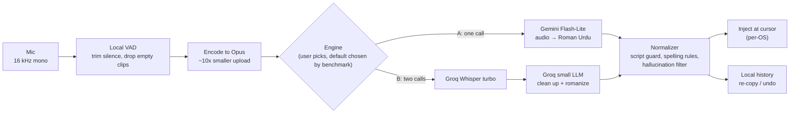

# SonicScript — Blueprint v1

**Speak Urdu, Hindi or English (or all three mixed). Get clean Roman Urdu / Hinglish text wherever your cursor is.**

| | |
|---|---|
| Status | Draft v1 (2026-10-26). Replaces v0 (kept in `archive/blueprint-v0.md`). |
| Owner | Ahsan |
| Goal order | 1. Fix my own daily typing problem. 2. Open-source it. 3. Grow an audience with it. |
| Principles | Cloud-first, free for the user, no server for the maintainer, one platform done well before the next. |

---

## 1. The problem

South Asians type Urdu and Hindi in **Latin script** ("Roman Urdu" / "Hinglish"), and mix in English all the time:

> *"PR merge kardo aur deployment check karlo, phir meeting mein discuss karte hain."*

Every built-in dictation tool gets this wrong:

1. **Wrong script.** Windows Voice Typing, Gboard and Apple Dictation output Urdu (اردو) or Devanagari (हिंदी) script. Nobody chats in those.
2. **Mixed speech breaks them.** English words inside Urdu sentences come out as phonetic gibberish or get translated.
3. **Slow and clumsy on desktop.** `Win + H` takes over a second to start, has no push-to-talk, and drops punctuation.

Spoken Urdu and Hindi are close to the same language, so one tool serves both **Pakistan and India**, a market of hundreds of millions of people with no good tool. That's the audience opportunity.

---

## 2. Product goals

### 2.1 What v1 must do
- **Hold a key, speak, release, and the text appears at the cursor** in any app (VS Code, Chrome, Slack, WhatsApp Web, terminals).
- Output is **Roman Urdu / Hinglish in Latin script**, with English words kept in normal English spelling.
- Works on **Windows** (my main machine) and **Android** (Pixel 6) first.
- **$0 per month** for personal use on free API tiers.
- The user brings their own free API key (**BYOK**). The maintainer runs no server and pays nothing.

### 2.2 Targets (measured, not assumed)

| Metric | Target | Notes |
|---|---|---|
| Latency, key release → text at cursor | **typical ≤ ~2 s**, with a fallback for slow requests (D-025) | Was p50 ≤ 700 ms, p95 ≤ 1.2 s; the owner put quality first on 2026-11-03: 1-2 s after stopping is fine. |
| Script correctness | ≥ 99% of outputs fully in Latin script when mode = Roman | Checked automatically: no Arabic/Devanagari code points. |
| English words kept English | ≥ 95% of English terms spelled in English | On the test set (§9). |
| Cost | $0 on free tiers. ≈ $0.15–0.20 per 1,000 dictations if paid. | See §4.3. |
| Idle footprint (desktop) | < 40 MB RAM, ~0% CPU | Always-on background app must be invisible. |

### 2.3 Out of scope for v1
- Running models **on the device**. The Pixel 6 is too slow for good local Whisper, and quality matters more. (A desktop offline fallback with `whisper.cpp` is a possible v2+ feature.)
- iOS (see §6.4: needs a Mac and a paid Apple account; moved to "later").
- Voice commands ("delete that", "new paragraph"), except a small set in v2.
- Translation (Urdu → English). Possibly a later mode.
- Our own backend, accounts, or payments.

---

## 3. How it works



### 3.1 Activation (D-015, D-016)
1. **Tap to toggle (default, M1).** Tap `Right Ctrl` to start (any allowed key or a mouse side button can be chosen instead, D-018); tap again or press **Enter** to stop, transcribe and paste; **Esc** cancels. Enter does not send the message (setting "Enter also sends", off by default).
2. **Push-to-talk (M1).** Hold the same key, speak, release. Works everywhere, including where focus detection fails.
3. **Pop-up mic (M2, before launch).** When a text field gets focus, a small mic pill appears near it (not recording). The key or a click on the pill starts it. Never on password fields; per-app off switch, terminals off by default.
   - Changed from v0: the mic **does not** start by itself when a field is focused. Always-listening would type background conversations into your chat, burn API quota, and look like spyware to new users. A "hands-free" toggle can come later.

### 3.2 Batch first, streaming later
- **v1 = batch.** Record the whole utterance, send once, insert once. Simple, cheap, and no flicker.
- **v2 = streaming preview.** While you speak, stream audio to a live transcription model (`gemini-3.5-transcribe-live`) and show interim text **inside our own HUD only**. On release, insert the final text once.
  - Typing interim text into other apps (as v0 proposed) means constant backspacing and rewriting, which breaks in many apps and fights autocomplete. We don't do that.
  - Streaming lowers perceived latency because most of the work happens while you're still talking.

### 3.3 Why the latency target is realistic only with these tricks
Network dominates the time budget. Planned optimisations:
- **Opus compression** before upload. A 10 s clip is ~320 KB as WAV and ~25–30 KB as Opus. On a typical Pakistani uplink this alone can save 300 ms or more.
- **Keep connections warm** (HTTP/2 keep-alive, pre-opened when the hotkey goes down).
- **Trim silence** at both ends with local VAD (Silero VAD, ~2 MB ONNX, fast even on the phone).
- **One API call instead of two** where quality allows (Engine A).
- Start encoding/uploading **while the key is still held** where the API supports chunked upload (investigate in Milestone 0).

---

## 4. Speech engines

### 4.1 Candidates (prices checked 2026-10-26)

| Engine | How | Paid price | Free tier | Notes |
|---|---|---|---|---|
| **A. Gemini Flash-Lite** (`gemini-3.5-flash-lite`, fallback `gemini-3.1-flash-lite`) | One call: audio + instruction "transcribe in Roman Urdu, keep English words in English" | ~$0.30 / 1M audio tokens in, $2.50 / 1M out | Yes | Hears the English words directly, so mixed speech should be cleanest. Google may use free-tier data to improve its products: disclose to users. |
| **B. Groq Whisper + small LLM** (`whisper-large-v3-turbo` → `llama-3.1-8b-instant` or `openai/gpt-oss-20b`) | Whisper outputs Urdu script; LLM converts to Roman and fixes English words | $0.04 / audio hour + ~$0.075 / 1M tokens | Yes (Whisper: 2,000 requests/day, 8 h audio/day) | Very fast inference, but two round trips. English words must be "recovered" from Urdu script, which can fail. |
| **B'. Whisper with a Roman-Urdu prompt** | Whisper's `prompt` field seeded with Roman Urdu example text, no LLM | $0.04 / audio hour | Yes | Cheapest and fastest if it works. Often unreliable; benchmark it anyway. |
| **C. Streaming** (`gemini-3.5-transcribe-live`) | WebSocket audio stream | ~$3.50 / 1M audio tokens | Yes | v2 streaming preview only. |
| Watch list | Mistral Voxtral (~$0.003/min), Deepgram, ElevenLabs Scribe | | | Add as providers later if they beat the above on our test set. |

Model names and free-tier limits change often. The app keeps model ids in config, not code, and the benchmark (§9) re-runs whenever we switch.

### 4.2 Choosing the default
**Milestone 0 decides**, using my own recordings: the engine with the best mix of correct script, English kept English, and p95 latency becomes the default. The others stay selectable in settings. The user picks a **preferred and a fallback model** from a catalog with the benchmark numbers (`spec/models.json`, D-017). If the preferred model fails, hits a rate limit, or passes its learned deadline (about 2x its usual time for that clip length), the fallback starts in parallel, the first answer wins, and a short notice says why.

### 4.3 Cost per dictation (typical 8-second clip)
- Engine A: ~260 audio tokens in + ~60 tokens out ≈ **$0.0002** → ~$0.20 per 1,000.
- Engine B: Whisper ≈ $0.00009 + LLM ≈ $0.00005 → ~$0.15 per 1,000.
- Personal use (~200 dictations/day) stays well inside both free tiers.

### 4.4 The prompt is the product
The romanization prompt is the heart of the project, so it's treated like code:
- Lives in `spec/prompts/` as versioned text files shared by every platform.
- Rules: Latin script only; English words in standard English spelling; preserve meaning exactly (never translate, summarise or answer); add punctuation and casing; numbers as digits.
- **Spelling style.** Roman Urdu has no standard spelling ("kar do" / "kardo", "hai" / "hay"). Ship a sensible default (common chat spellings: *hai, kar do, nahi, kya*), plus a user setting and a **personal word list** (names, product terms like "Taskvane", "PR", "Kubernetes") injected into the prompt.
- Output modes: **Roman Urdu/Hinglish** (default), **English only**, **Urdu script**, **Devanagari**. The last two are cheap to add and widen the audience.

### 4.5 Normalizer (runs locally after the model)
- **Script guard:** if Arabic/Devanagari characters slip through in Roman mode, re-ask the LLM once, or transliterate with rules.
- **Hallucination filter:** Whisper invents text on near-silence ("Thank you for watching", "Subtitles by..."). Drop clips that VAD says are empty, and strip known phantom phrases.
- **Spacing:** add a leading space when inserting after a word; no double spaces.
- Rules live as data in `spec/normalizer/` with shared test cases, so every platform behaves identically.

---

## 5. Architecture

### 5.1 Repository layout (monorepo)
```
sonic-script/
  spec/                 shared contract every platform follows
    prompts/            romanization prompts (versioned)
    normalizer/         rules + test cases (JSON)
    providers.json      model ids, endpoints, limits
    fixtures/           test audio + expected text (my voice, with consent)
  eval/                 Python benchmark + accuracy harness (Milestone 0, reused forever)
  desktop/              Rust workspace
    core/               audio, VAD, encoding, providers, normalizer, history
    platform-windows/   hotkey, focus (UI Automation), injection, overlay
    platform-linux/     X11 + Wayland backends
    app/                Tauri shell: tray, settings, HUD
  android/              Kotlin: IME keyboard app
  ios/                  later
  docs/                 PRD, architecture, decisions, status (project memory)
```

### 5.2 Key technical choices

| Decision | Choice | Why |
|---|---|---|
| Desktop language | **Rust** core + **Tauri** for settings/HUD | Always-on background app: small binary (~10 MB), low RAM, one codebase for Windows and Linux. Python would be faster to write but heavier at idle, harder to ship, and more often flagged by antivirus. |
| Shared logic across platforms | **Shared spec + golden tests**, not shared code (for now) | The core logic is small (record → HTTP call → normalise). Re-implementing it in Kotlin against the same fixtures is simpler than Rust-on-Android via UniFFI. Revisit if the logic grows. |
| API keys | **BYOK**, stored in the OS keystore (Windows Credential Manager, libsecret, Android Keystore) | No backend, no cost, no user data passes through us. Easiest kind of open-source project to trust. |
| Benchmark tool | **Python** (`eval/`) | Quick to write; only calls APIs on recorded files. |
| License | **MIT** (decided 2026-11-02, D-012) | Shortest, best-known permissive license; easy for contributors. |

### 5.3 Privacy model (write it in the README)
- Audio is sent **only** to the provider the user picked, using **their own key**, and only while they dictate.
- Nothing is stored on any server we run (we run none). History stays on the device and can be turned off.
- No telemetry by default. An opt-in, anonymous latency report may come later.

---

## 6. Platforms

### 6.1 Windows 10/11 (first)
- **Hotkey:** low-level keyboard hook (`SetWindowsHookEx(WH_KEYBOARD_LL)`), so hold-to-talk works in every app.
- **Text injection, in order of preference:**
  1. **Clipboard paste:** save clipboard → put our text → `SendInput` Ctrl+V → restore clipboard. Mark our clipboard entry so it **doesn't pollute Win+V clipboard history** (`ExcludeClipboardContentFromMonitorProcessing`).
  2. **Terminals** (Windows Terminal, conhost) use `Ctrl+Shift+V`; detect by window class.
  3. **Unicode typing** (`SendInput` with `KEYEVENTF_UNICODE`) as a fallback for apps where paste fails.
  - Known limit: Windows blocks input into **admin (elevated) windows** from a normal app (UIPI). Show a notice instead of failing silently.
- **Focus detection (for the focus pill):** **UI Automation** focus events, checking whether the focused element is an editable control (Edit control type, or Value/Text pattern and not read-only).
  - v0 used `GetGUIThreadInfo` / `rcCaret`. That returns nothing for Chrome, VS Code, Slack and other Electron apps, which is most of what I use, so UI Automation is required.
- **Overlay HUD:** small always-on-top pill with a live mic level ring. Window styles `WS_EX_NOACTIVATE | WS_EX_TOOLWINDOW | WS_EX_TOPMOST | WS_EX_TRANSPARENT` (click-through except the pill itself), so it never steals focus.
- **Tray:** status, mode (Roman / English / ...), history, settings, pause.
- **Distribution:** installer from GitHub Releases + **winget**. Unsigned apps that hook the keyboard trigger SmartScreen and antivirus warnings, so apply for free open-source code signing (**SignPath Foundation**) before the public launch.

### 6.2 Android, Pixel 6 (second)
- **Voice keyboard (IME):** an `InputMethodService` app. Pick it like any keyboard; a big mic button sits in the middle, with a switch-back-to-Gboard key, backspace, space, enter and the history list.
- Insertion with `InputConnection.commitText()`: reliable in every app and needs no accessibility permission.
- Recording: `AudioRecord` 16 kHz → Silero VAD (ONNX Runtime Mobile) → Opus (`MediaCodec`) → same providers as desktop.
- Quick switch: Android shows a keyboard-switch button in the nav bar, so jumping Gboard ↔ SonicScript is one tap.
- **Dropped from v0:** the floating accessibility bubble over Gboard. It needs Accessibility + overlay permissions, the Play Store restricts accessibility use for non-accessibility apps, and it looks alarming to new users. Can return as an experimental sideload-only feature if people ask for it.
- **Distribution:** APK on GitHub Releases first, then F-Droid (no proprietary libraries needed) and Google Play ($25 one-time).

### 6.3 Ubuntu (third)
Ubuntu's default session is **GNOME on Wayland**, which is much more locked down than X11.

| Feature | X11 | GNOME Wayland |
|---|---|---|
| Global hotkey | XGrabKey / XInput | **XDG GlobalShortcuts portal** (newer GNOME). Fallback: user binds a GNOME custom shortcut to `sonicscript toggle` (a CLI command we ship). |
| Inject text | `xdotool` / XTest + clipboard | **RemoteDesktop portal + libei** (user approves once). Fallback: `ydotool` (needs `uinput` access). `wtype` doesn't work on GNOME. |
| Clipboard | X selection | `wl-clipboard` / portal |
| Overlay near the cursor | Override-redirect window | **Not possible**: GNOME doesn't support `wlr-layer-shell` (that's for Sway/Hyprland). Use a small normal window or notification, or a GNOME Shell extension later. |
| Focus detection | AT-SPI over D-Bus | AT-SPI over D-Bus (works) |

So Linux v1 = push-to-talk everywhere; the focus pill on X11 only.

### 6.4 iPhone 12 (later, optional)
- Blockers: building iOS apps needs a **Mac** (or rented cloud Mac); installing on a device needs Xcode signing (free signing expires every 7 days; the Apple Developer Program is $99/year).
- When possible: a small app with an **App Intent** using `AudioRecordingIntent` (iOS 18), triggered by **AssistiveTouch** (custom tap action → Shortcut) or **Back Tap**. Speak → text copied to the clipboard → paste.
- Keyboard extensions can't use the mic on iOS, so a keyboard can only bounce to the app and back. Skip it.
- iPhone 12 has no Action Button and no Dynamic Island; v0's Phase 4 mentioned both. Removed.
- Good candidate for a community contributor with a Mac after launch.

---

## 7. Failure handling

| Situation | Behaviour |
|---|---|
| No internet / API down | Keep the recording; HUD shows "offline, will retry"; retry on the fallback provider; never lose audio silently. |
| Rate limit (free tier) | Switch to the other provider if it has a key; otherwise tell the user how long to wait. |
| Injection failed | Text stays in history and on the clipboard; HUD says "copied, press Ctrl+V". |
| Empty / silent clip | Not sent at all (VAD). No phantom text. |
| Very long clip (> 2 min) | Split at silences, send in parts, join in order. |
| Wrong script in output | Normalizer script guard (§4.5). |
| Bad key | Clear message in settings with a link to get a free key. |

---

## 8. Milestones

Every milestone ends with something I use daily or a measured result, not just code.

| # | Milestone | Done when | Rough size |
|---|---|---|---|
| **M0** | **Engine benchmark** (`eval/`): record ~40 real sentences (Urdu, English, mixed, tech-heavy, names); run engines A / B / B' from Pakistan | Results table: script correctness, English-kept rate, p50/p95 latency, cost. Default engine chosen and written down as a decision. | 2–3 days |
| **M1** | **Windows push-to-talk MVP** (Rust): hotkey → record → VAD → Opus → provider → normalizer → paste | I use it all day for 3 days instead of typing. Latency logged locally. | ~1 week |
| **M2** | **Windows polish:** tray, settings (model catalog, keys in Credential Manager, preferred + fallback model, hotkey picker ("press a key"), mode, word list), HUD ring, **pop-up mic on text fields** (D-016), history, retries, learned-deadline fallback (D-017) | A non-technical friend installs it from a release and dictates within 2 minutes. | ~1 week |
| **M3** | **Android IME** (Kotlin): same pipeline, same fixtures pass | I use it in WhatsApp for a week. | ~2 weeks |
| **M4** | **Public launch v1.0** (Windows + Android) | README with demo GIF/video, signed installer, winget, APK, privacy section, contributing guide. Launch posts (§10). | ~1 week |
| M5 | ~~Focus pill on Windows~~ moved into M2 (D-016) | | |
| M6 | Ubuntu (X11 full, Wayland push-to-talk) | Works on Ubuntu 24.04+ in both sessions. | ~1–2 weeks |
| M7 | Streaming preview (v2) | Interim text in the HUD; final insert unchanged. | ~1 week |
| M8 | iOS (if a Mac is available) | Back Tap → speak → clipboard. | — |

Why launch after M4 rather than at the end: Windows + Android covers most of the audience, and real users will shape M5–M8 better than guesses.

---

## 9. Testing and quality
- **Golden audio set** (`spec/fixtures/`): my recordings plus expected text. Every engine/prompt change runs through `eval/` and must not get worse.
- **Automatic checks:** zero Arabic/Devanagari characters in Roman mode; listed English terms present in English spelling; a spelling-tolerant comparison (normalises *kar do*/*kardo*) for overall accuracy.
- **Unit tests** for the normalizer (shared JSON cases across Rust and Kotlin), VAD trimming, and clip splitting.
- **Manual test matrix** per release: Notepad, Chrome, VS Code, Slack/Discord, Windows Terminal, **Claude Code and Codex CLI prompts in a terminal** (a core use case), an elevated window; WhatsApp, Gmail, Chrome on Android.
- **CI** (GitHub Actions): Rust build + tests on Windows and Linux, Android build + tests, release artifacts on tags.
- **Project memory:** decisions, status and architecture live in `docs/` and are updated with every change, so any coding agent (Claude, Gemini, Codex) can pick up the work cleanly.

---

## 10. Open-source launch and audience
- **Hook:** "Dictation that finally types the way Pakistan and India actually text." Show a 20-second side-by-side: `Win+H` producing Urdu script vs SonicScript producing Roman Urdu with English tech words intact.
- **Where:** GitHub (good README, demo GIF, topics: `roman-urdu`, `hinglish`, `speech-to-text`, `dictation`), Reddit (r/pakistan, r/india, r/developersIndia, r/opensource), Hacker News "Show HN", X/LinkedIn, Instagram reels in Hinglish (same format as my other ad reels), YouTube demo.
- **Make contributing easy:** `good first issue` labels, providers as plug-ins (add Deepgram/Voxtral = one file), and a call for **voice samples in other dialects** (Punjabi-mixed, Hyderabadi, Bambaiya) to grow the test set.
- **Before launch:** check that the name "SonicScript" is free on GitHub, the Play Store and as a domain.

---

## 11. Risks

| Risk | Impact | Mitigation |
|---|---|---|
| Free tiers shrink or models get retired | Users start paying, or the app breaks | Multiple providers, model ids in config, benchmark before switching, cost clearly shown. |
| Latency from Pakistan misses targets | Feels slow | Opus, warm connections, single-call engine, streaming preview in v2. Measured in M0 before committing. |
| Antivirus / SmartScreen flags the keyboard hook | Users can't install | Code signing (SignPath), open source build from CI, clear README note. |
| Roman Urdu spelling feels "wrong" to users | Bad first impression | Spelling style setting + personal word list; collect feedback early. |
| Privacy concerns (audio to Google/Groq) | Trust | BYOK, clear README section, no telemetry, provider choice. |
| Scope creep across 4 platforms | Nothing gets finished | Strict order: Windows → Android → launch → the rest. |

---

## 12. Decisions and open questions
**Decided (2026-10-27):**
1. **Default hotkey: hold `Right Ctrl`.** One key, under the right thumb, does nothing on its own in almost every app (so holding it is harmless), and stays out of the way of terminal shortcuts that Claude Code / Codex users rely on. Configurable; a mouse side button is offered as an alternative.
2. **No Mac available.** iOS stays "later" and is offered to community contributors. Free GitHub macOS runners (public repos) can at least build it in CI.
3. **Compression:** use the smallest Opus bitrate at which accuracy does not drop, measured in M0.
4. **M0 benchmark in Python; the Windows app in Rust** (see §5.2).

**Still open:**
1. **License:** MIT (decided 2026-11-02, D-012).
2. **Name:** keep "SonicScript" (subject to the availability check), or rename for Urdu/Hindi users?

---

## 13. Changes from v0 (summary)
- Latency target made realistic (p95 ≤ 1.2 s, 500 ms as a stretch) and must be measured first (new M0).
- Added a **single-call Gemini engine** next to Groq Whisper + LLM; the default is chosen by benchmark, not assumed. Updated model names to current ones.
- **BYOK, no server**: the app is free for users and the maintainer.
- Added Opus compression, warm connections, hallucination filter, script guard, spelling style, word list, history, failure handling.
- Focus pill no longer auto-starts the mic; streaming text shown in our HUD instead of typed into other apps.
- Windows focus detection switched to **UI Automation** (v0's caret API fails in Chrome/Electron).
- Linux: corrected Wayland (GNOME has no layer-shell; use portals and a CLI fallback).
- Android: keyboard (IME) only; accessibility bubble dropped.
- iOS moved to "later" (needs a Mac and a paid account); removed Action Button / Dynamic Island references for the iPhone 12.
- Replaced the generic "big-tech" docs section with a concrete repo layout, test strategy and launch plan.
- Added Hindi/Devanagari and Urdu-script output modes to reach both Pakistan and India.
